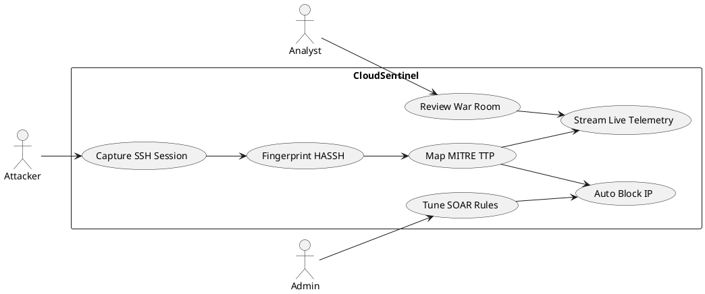
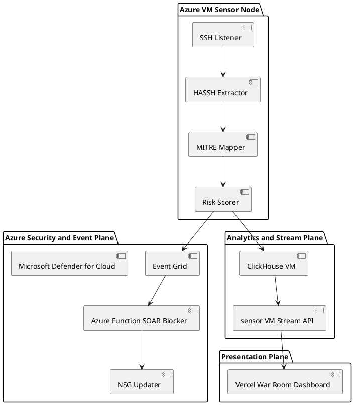
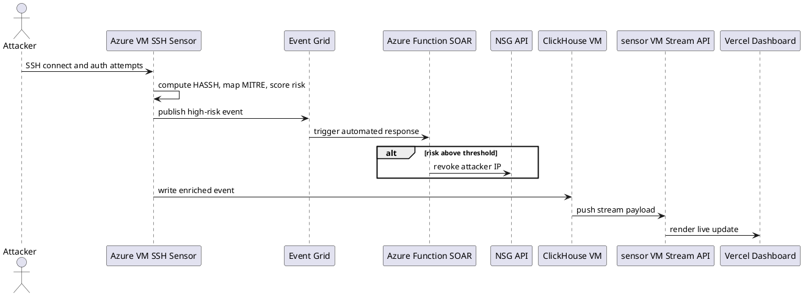
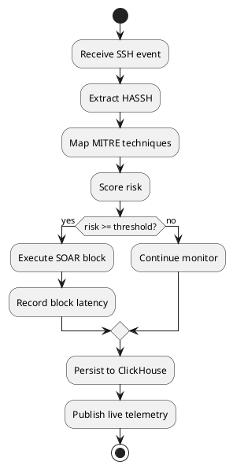
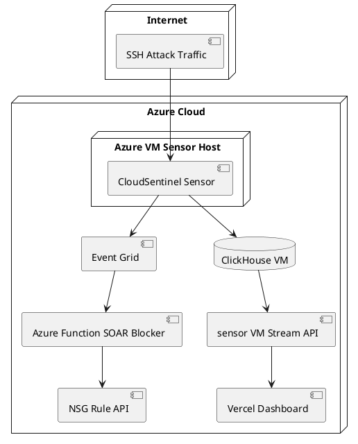
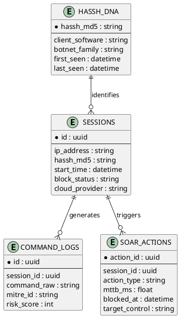
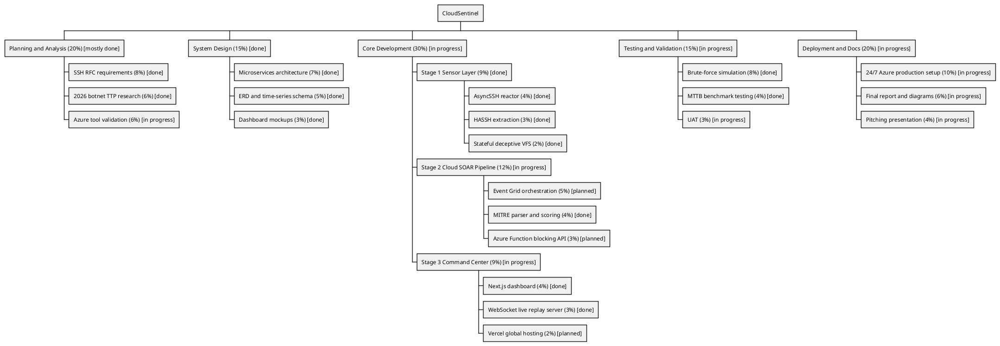

# CloudSentinel Skill File v3.0

> Project: CloudSentinel - Event-Driven SSH Deception and SOAR
> Author: Radzi bin Zamri (I24107504)
> Supervisor: Sir Helmy Hanyff Bin Hairudin Ruzaili
> Faculty: FPTM, Universiti Sultan Azlan Shah (USAS)
> Type: Final Year Project (FYP)
> Last Updated: 2026-06-01
> Current Delivery State: Phase 1 deployed and validated on 2026-05-26; droplet now offline. Phase 2 prepared for Azure migration.

---

## 1. Project Metadata

| Field | Value |
|---|---|
| System Name | CloudSentinel |
| Domain | Cybersecurity, Honeypot, Active Deception, SOAR |
| Primary Threat Focus | SSH botnet campaigns on port 22 |
| Deployment Strategy | Two-phase: DigitalOcean (Dev and MVP) then Azure (Production-ready) |
| Architecture | Event-driven, service-boundary, cloud-agnostic core logic |
| Frontend | Next.js 16, React 19, TypeScript, TailwindCSS 4 |
| Phase 1 Host | DigitalOcean Droplet (sensor + SOAR + stream + ClickHouse) |
| Phase 1 Dashboard | Vercel |
| Phase 2 Target Host | Azure VM sensor + Event Grid + Azure Functions + NSG + self-hosted ClickHouse + Vercel |
| Key Performance Metric | MTTB measured; local dry-run median 0.962 ms |
| Latest Evidence | Median MTTB 0.962 ms (micro benchmark) and p95 MTTB below 1000 ms up to 600 concurrent events (local dry-run SOAR probe) |

---

## 2. Problem and Direction

CloudSentinel is built to stop high-speed automated SSH attacks where manual blocking fails.  
The system captures attacker behavior, fingerprints client identity using HASSH, maps behavior to MITRE ATT&CK, and auto-contains attacker IP with SOAR.

Current direction:
- Keep the local demo pipeline stable; the Phase 1 droplet is offline.
- Ensure telemetry truth from ClickHouse to dashboard.
- Measure MTTB under realistic load and report the actual value.

Phase 2 direction:
- Keep detection and intelligence logic unchanged.
- Move orchestration and blocking primitives to Azure services while keeping the core cloud-agnostic.

---

## 3. Research Alignment

| ID | Research Question | Objective |
|---|---|---|
| RQ1 | How can SSH-focused honeypot systems detect modern botnets with high confidence? | Build identity-centric SSH telemetry using HASSH and behavior analytics |
| RQ2 | How can a cloud-hosted honeypot block SSH attacks automatically? | Deliver automated containment for high-risk SSH attackers |
| RQ3 | How can cloud migration preserve logic while improving scalability? | Use cloud-agnostic core and migrate infra from DO to Azure |

---

## 4. Current System Reality (2026-06-01)

### 4.1 Phase 1 Deployment (validated 2026-05-26, now offline)

The droplet is offline. These are historical facts from the project artifacts:
- Phase 1 validation overall: PASS
- SSH honeypot: PASS
- Management SSH: PASS
- Socket.io port: PASS
- MITRE techniques: 20 catalogued, 17 mapped from commands
- Redis connected: True
- Stream enabled: True
- MTTB benchmark: median 0.962 ms, p95 1.5 ms

### 4.2 Core Engine Capabilities (Implemented)

- Unified async sensor entrypoint for SSH plus service modules.
- HASSH fingerprinting with real MD5 fingerprint set.
- MITRE ATT&CK mapping with regex and behavioral signatures.
- SOAR engine with automatic IP blocking.
- Redis stream pipeline plus ClickHouse persistence.
- Live telemetry stream for war-room UI.
- Prometheus metrics and structured observability.
- Admin API and secured operations endpoint.

---

## 5. Updated Two-Phase Architecture

### Phase 1 (validated, now offline): DigitalOcean
- Internet -> SSH Sensor -> HASSH + MITRE + Risk -> Local SOAR block -> ClickHouse -> Socket.io -> Vercel dashboard

### Phase 2 (Target): Azure
- Internet -> Azure VM Sensor -> Event Grid -> Azure Function SOAR -> NSG rule; ClickHouse VM -> sensor VM stream -> Vercel dashboard

### Migration rule
Only infrastructure adapters change. Core detection logic remains same.

---

## 6. Improved WBS (Percent + Current Status)

```text
PROJECT: CLOUDSENTINEL (100%)

1. PLANNING AND ANALYSIS (20%) [Mostly Done]
1.1 SSH RFC Requirements (8%) [Done]
1.2 2026 Botnet TTP Research (6%) [Done]
1.3 Azure Tool Validation (6%) [In Progress]

2. SYSTEM DESIGN (15%) [Done]
2.1 Microservices Architecture (7%) [Done]
2.2 ERD and Time-Series Schema Design (5%) [Done]
2.3 Dashboard Mockups and UX Direction (3%) [Done]

3. CORE DEVELOPMENT (30%) [In Progress]
3.1 STAGE 1 SENSOR LAYER (9%) [Done]
3.1.1 AsyncSSH Reactor Implementation (4%) [Done]
3.1.2 HASSH Extraction Engine (3%) [Done]
3.1.3 Stateful Deceptive VFS Logic (2%) [Done]

3.2 STAGE 2 SOAR PIPELINE (12%) [Done on DO, Azure Adapter Planned]
3.2.1 DigitalOcean Local SOAR Blocking (iptables) [Done]
3.2.2 Event Grid Orchestration Adapter (5%) [Planned]
3.2.3 MITRE ATT&CK Parser and Risk Scoring (4%) [Done]
3.2.4 Azure Function Blocking API Adapter (3%) [Planned]

3.3 STAGE 3 COMMAND CENTER (9%) [In Progress]
3.3.1 Next.js Dashboard Build (4%) [Done]
3.3.2 WebSocket Live Replay Server (3%) [Done]
3.3.3 Global Hosting Migration to Vercel (2%) [Planned]

4. TESTING AND VALIDATION (15%) [In Progress]
4.1 Brute-force Simulation (8%) [Done]
4.2 MTTB Benchmark Testing (4%) [Done, 600-concurrency local dry-run p95 under 1000 ms]
4.3 User Acceptance Testing UAT (3%) [In Progress]

5. DEPLOYMENT AND DOCUMENTATION (20%) [In Progress]
5.1 24/7 Production Setup (DO Live, Azure Next) (10%) [In Progress]
5.2 Final Report and Diagrams (6%) [In Progress]
5.3 Pitching Presentation (4%) [In Progress]
```

---

## 7. SSH Botnet Specialization Matrix

CloudSentinel specializes in SSH-centric adversaries.

### 7.1 General SSH Botnet Families
- Mirai variants
- Gafgyt (Bashlite) variants
- Mozi
- Hajime
- Tsunami
- Kaiten
- Mayday
- Linux.BackDoor.Fgt
- XOR.DDoS
- BillGates botnet

### 7.2 Scanner and Tooling Fingerprints
- Nmap
- Zgrab2
- Masscan
- SSH-audit

### 7.3 SSH Attack Behavior Categories
- Brute-force credential stuffing
- Default credential replay
- Recon command bursts (`uname`, `id`, `cat /proc/cpuinfo`)
- Downloader execution (`wget`, `curl`, payload fetch)
- Persistence attempts (`crontab`, startup script edits)
- Lateral movement prep over SSH trust paths

---

## 8. KPI and Performance Targets

| Metric | Target | Current Evidence |
|---|---|---|
| MTTB | measured; local dry-run median 0.962 ms | p95 1.5 ms; p95 stays under 1000 ms up to 600 concurrent events; 800 concurrent reaches 1009.892 ms |
| MITRE technique coverage | 15+ | 17 of 20 catalogued techniques mapped from commands |
| Pipeline availability | High uptime for live capture | Phase 1 validation PASS |
| Telemetry truth | Dashboard must reflect ClickHouse truth | Truth QA runbook available |

---

## 9. PlantUML Pack (Updated)

### 9.1 Use Case Diagram


### 9.2 Component Diagram


### 9.3 Sequence Diagram (Phase 2 Azure)


### 9.4 Activity Diagram (Detection to Block)


### 9.5 Deployment Diagram (Phase 2 Azure Only)


### 9.6 ER Diagram


### 9.7 WBS Diagram (PlantUML WBS)


---

## 10. AI Working Directives

- Use this file as living reference for current architecture and delivery status.
- Do not describe Phase 1 as currently live. The droplet is offline; cite the validation artifact.
- Do not invent metrics not backed by artifacts.
- Never send raw secrets to an LLM. Use `redact_secrets` and the per-session and global call limits.
- Use artifact-backed metrics. Do not promise a fixed sub-second target.
- Preserve SSH botnet specialization in any feature extension.
- For migration tasks, separate "core logic" from "cloud adapter" changes.

---

## 11. Source Anchors for This Update

- `docs/ARCHITECTURE.md`
- `docs/INDEX.md`
- `artifacts/mttb-benchmark.md`
- `artifacts/phase1-validation.md`
- `docs/DEPLOY.md`
- `docs/CLICKHOUSE_TRUTH_QA.md`
- `src/cloudsentinel/PROJECT_STRUCTURE.md`
- `dashboard/src/components/AIChatAgent.tsx`
